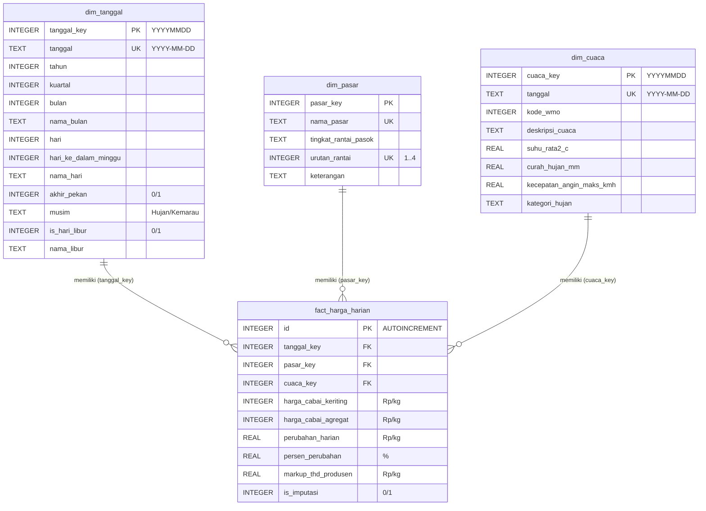

# Entity Relationship Diagram (ERD) — Data Warehouse Cabai Merah Keriting Kota Medan

Dokumen ini menjelaskan rancangan **Skema Bintang (Star Schema)** untuk Data Warehouse pada `warehouse/cabai_medan.db` sesuai kontrak teknis di [schema.sql](file:///Users/damesisri/Documents/untitled%20folder/da-ds-2026-kelompok-25/warehouse/schema.sql).

## 1. Diagram Relasi Entitas (Skema Bintang)

## 2. Grain & Ringkasan Tabel

- **Grain Tabel Fakta (`fact_harga_harian`)**: Setiap baris merepresentasikan harga harian **1 komoditas (Cabai Merah Keriting)** pada **1 tanggal hari kerja** dan **1 kategori pasar** di Kota Medan (periode irisan `2019-12-31` s.d. `2026-01-29`, total 1.588 hari kerja × 4 pasar = 6.352 baris).

| Tabel | Jenis | Primary Key | Deskripsi Singkat |
|---|---|---|---|
| `fact_harga_harian` | Fakta | `id` | Fakta harga cabai harian, perubahan harian, persentase perubahan, markup terhadap produsen, dan flag imputasi. |
| `dim_tanggal` | Dimensi | `tanggal_key` | Atribut kalender harian, kuartal, musim (Hujan/Kemarau), serta flag hari libur nasional Indonesia. |
| `dim_pasar` | Dimensi | `pasar_key` | 4 tingkat rantai pasok PIHPS: `Produsen` (1), `Pedagang Besar` (2), `Pasar Tradisional` (3), dan `Pasar Modern` (4). |
| `dim_cuaca` | Dimensi | `cuaca_key` | Data cuaca harian Kota Medan (Open-Meteo): kode WMO, deskripsi cuaca, suhu rata-rata, curah hujan, kecepatan angin, dan kategori hujan. |
| `v_harga_lengkap` | SQL View | — | Gabungan denormalisasi `fact_harga_harian` dengan ketiga dimensi untuk kebutuhan dashboard Streamlit dan pelatihan model ML. |

## 3. Definisi Metrik Turunan pada Tabel Fakta

1. **`perubahan_harian` (Rp/kg)**: Selisih `harga_cabai_keriting` hari ini terhadap hari kerja sebelumnya pada pasar yang sama (`NULL` pada hari pertama masing-masing pasar).
2. **`persen_perubahan` (%)**: Persentase perubahan harga harian: `(perubahan_harian / harga_sebelumnya) * 100`.
3. **`markup_thd_produsen` (Rp/kg)**: Selisih `harga_cabai_keriting` pada pasar tertentu terhadap harga `Produsen` pada tanggal yang sama (bernilai `0` untuk pasar `Produsen`).
4. **`is_imputasi` (0/1)**: Penanda apakah harga pada tanggal tersebut merupakan hasil imputasi *forward-fill* (`1`) karena ketidaksediaan laporan pada hari libur/cuti bersama, atau data asli PIHPS (`0`).
